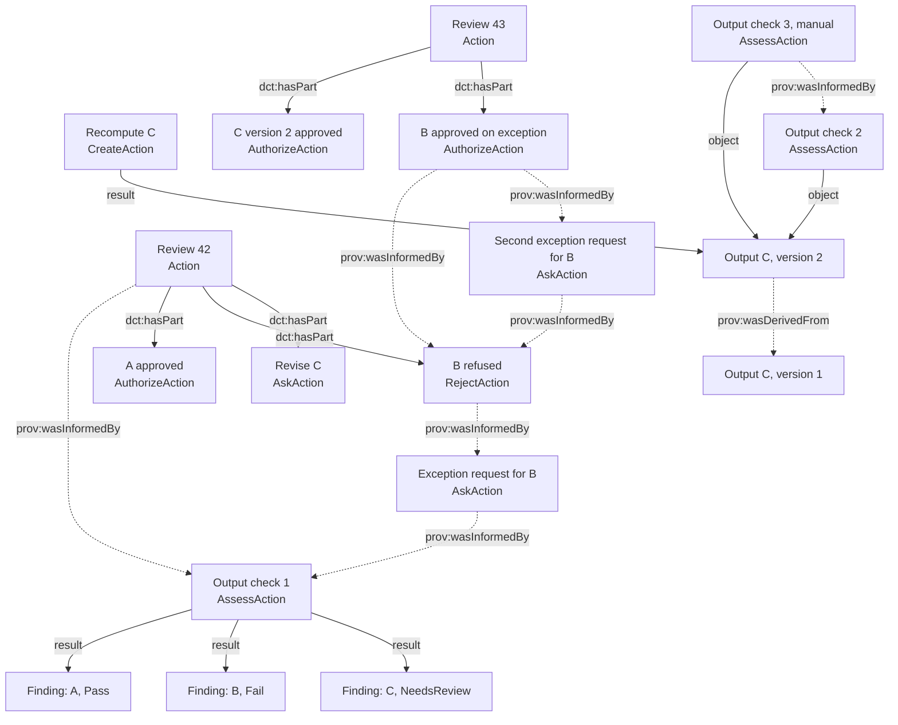

# Module: Statistical Output Checking

A module of the [Five Safes RO-Crate profile](../index.md). It is declared alongside the core profile in an RO-Crate's `conformsTo`, as described in [Conformance and Modules](../index.md#conformance-and-modules).

* Permalink: <https://w3id.org/5s-crate/1.0-DRAFT/modules/statistical-output-checking>
* Profile of: <https://w3id.org/5s-crate/1.0-DRAFT>, identified with `isProfileOf` on the module's Profile entity
* Version: 1.0-DRAFT
* Status: Working Draft
* Published: 2027-XX-XX
* Comments and suggestions: <https://github.com/eScienceLab/Five-Safes-RO-Crate/issues>

_The key words "MUST", "MUST NOT", "REQUIRED", "SHALL", "SHALL NOT", "SHOULD", "SHOULD NOT", "RECOMMENDED", "NOT RECOMMENDED", "MAY", and "OPTIONAL" in this document are to be interpreted as described in BCP 14 [[RFC2119](https://doi.org/10.17487/RFC2119)] [[RFC8174](https://doi.org/10.17487/RFC8174)] when, and only when, they appear in all capitals, as shown here._

## Scope

This module defines the metadata needed to record checks of statistical outputs, such as tables, figures, and summary statistics, before release from a TRE.

The Five Safes RO-Crate core records an output check as an `AssessAction`, the overall review as an `Action`, and approval, refusal and requests as `AuthorizeAction`, `RejectAction` and `AskAction` (see: [Output Checking and Release Decisions](../index.md#output-checking-and-release-decisions)). This module captures what a statistical check needs on top of that layer:

| Addition | Purpose |
|---|---|
| A published term that marks a check as a statistical output check | A validator, a consumer, or sibling module can identify the check from any other assessment. |
| A finding for each output, with one of three outcomes | The record describes what the check found about each output, whoever or whatever performed it, and a decision can be read against it. |
| The kind of statistic on the output | A consumer knows which risks and rules applied without opening the report. |
| Optional published terms for risks, evaluations and controls | A producer who has this information records it with its published meaning. |

!!! tip
    If an RO-Crate already conforms to the Five Safes RO-Crate profile, two things need to be added: the module IRI under the Root Data Entity's `conformsTo`, and the module term under each check's `additionalType`. 
    
Note that this module does not prescribe which tool a TRE uses, how a check is run, or in what order checks, requests and decisions happen. A check performed entirely by a person conforms with the same metadata as one performed by software, and a check performed by software is attributed as the Five Safes RO-Crate core describes in [Who Performed a Process](../index.md#who-performed-a-process).

## Entities

| Entity | Described as | What it records |
|---|---|---|
| Statistical output check | An `AssessAction` whose `additionalType` includes the module term | One occasion of checking: a session of a checking tool, or one person's examination of a batch of outputs. |
| Finding | A `CreativeWork` listed under the check's `result`, with `about` naming one output and an outcome term in `additionalType` | What the check found about that output. |
| Output | The asset the check examined, as in the Five Safes RO-Crate core: a `Dataset` or other `CreativeWork` with an absolute IRI, with any packaged copies | The thing that is checked, decided on, and released. |
| Policy or configuration | A `CreativeWork` with an absolute IRI and `version`, named as the check's `instrument` | The disclosure control rules and thresholds the check applied. |

The following fragment records one check of three outputs by a tool, attributed to the TRE as agent with the tool and the policy version as instruments. Each output has its own finding:

```json
[
  {
    "@id": "https://tre72.example.org/activities/A123/checks/check-1",
    "@type": ["AssessAction", "prov:Activity"],
    "additionalType": [
      {"@id": "https://w3id.org/5s-crate/1.0-DRAFT/modules/statistical-output-checking#StatisticalOutputCheck"},
      {"@id": "https://w3id.org/dpv/risk#RiskAssessment"}
    ],
    "name": "Output check 1: automated disclosure risk assessment",
    "agent": {"@id": "https://ror.org/027m9bs27"},
    "provider": {"@id": "https://ror.org/027m9bs27"},
    "instrument": [
      {"@id": "https://doi.org/10.5281/zenodo.18456450"},
      {"@id": "https://tre72.example.org/policies/sdc/v4"}
    ],
    "object": [
      {"@id": "https://tre72.example.org/activities/A123/assets/count/v1"},
      {"@id": "https://tre72.example.org/activities/A123/assets/count-by-site/v1"},
      {"@id": "https://tre72.example.org/activities/A123/assets/count-by-age/v1"}
    ],
    "result": [
      {"@id": "checks/check-1/results.json"},
      {"@id": "https://tre72.example.org/activities/A123/checks/check-1/findings/count"},
      {"@id": "https://tre72.example.org/activities/A123/checks/check-1/findings/count-by-site"},
      {"@id": "https://tre72.example.org/activities/A123/checks/check-1/findings/count-by-age"}
    ],
    "startTime": "2027-03-14T14:00:00Z",
    "endTime": "2027-03-14T14:00:12Z",
    "actionStatus": {"@id": "http://schema.org/CompletedActionStatus"}
  },
  {
    "@id": "https://tre72.example.org/activities/A123/checks/check-1/findings/count",
    "@type": "CreativeWork",
    "additionalType": {"@id": "https://w3id.org/5s-crate/1.0-DRAFT/modules/statistical-output-checking#Pass"},
    "about": {"@id": "https://tre72.example.org/activities/A123/assets/count/v1"},
    "description": "All cells at or above the minimum threshold."
  },
  {
    "@id": "https://tre72.example.org/activities/A123/checks/check-1/findings/count-by-site",
    "@type": "CreativeWork",
    "additionalType": {"@id": "https://w3id.org/5s-crate/1.0-DRAFT/modules/statistical-output-checking#Fail"},
    "about": {"@id": "https://tre72.example.org/activities/A123/assets/count-by-site/v1"},
    "description": "Minimum threshold check failed: four cells below the threshold. A linked table check needs a person."
  },
  {
    "@id": "https://tre72.example.org/activities/A123/checks/check-1/findings/count-by-age",
    "@type": "CreativeWork",
    "additionalType": {"@id": "https://w3id.org/5s-crate/1.0-DRAFT/modules/statistical-output-checking#NeedsReview"},
    "about": {"@id": "https://tre72.example.org/activities/A123/assets/count-by-age/v1"},
    "description": "A linked table check needs a person: the age bands overlap an earlier release."
  },
  {
    "@id": "https://tre72.example.org/activities/A123/assets/count-by-site/v1",
    "@type": "Dataset",
    "additionalType": {"@id": "https://w3id.org/statbarnsdc#Crosstabs"},
    "name": "Cohort count by site, version 1",
    "version": "1"
  },
  {
    "@id": "https://tre72.example.org/policies/sdc/v4",
    "@type": "CreativeWork",
    "name": "TRE72 statistical disclosure control policy, version 4",
    "version": "4"
  }
]
```

A check performed by a person has the same shape, with the person as `agent`, the policy version as `instrument` where it helped, and a finding for each output the person examined. A tool that checks each output as it is produced is recorded as one check for the session, and a person who works through a batch is recorded as one check for the batch.

## Requirements

A **statistical output check** is an entity whose `additionalType` includes `https://w3id.org/5s-crate/1.0-DRAFT/modules/statistical-output-checking#StatisticalOutputCheck`. That value is how the module selects the checks it applies to, and without it, an `AssessAction` is an ordinary Five Safes RO-Crate check. 

A **finding** is an entity whose `additionalType` includes a term from the module's [outcome set](#outcomes).

A working record or snapshot that declares this module MUST record at least one statistical output check under the Root Data Entity's `mentions`.

### The Check

| Property | Requirement | Description |
|---|---|---|
| `additionalType` | MUST include the module term <br><br> SHOULD include `https://w3id.org/dpv/risk#RiskAssessment` where the check identified, analysed or evaluated disclosure risk | The module term marks the check and is how it is selected. Further published terms MAY be added. |
| `@type` | MUST include `AssessAction` | [Process Shape](../index.md#process-shape) and [Output Checks](../index.md#output-checks) in the Five Safes RO-Crate core then apply. |
| `result` | SHOULD identify at least one finding for each `object`, where `actionStatus` is `CompletedActionStatus`; <br><br> MAY identify a report; <br><br> MUST NOT identify an `AuthorizeAction` or `RejectAction` | An active or failed check is not expected to have findings. A check with no `actionStatus` fails the Process Shape requirements. |
| `instrument` | SHOULD identify the exact version of the policy or configuration that set the check's criteria, and any software, where either helped perform the check | A copy of a configuration file is packaged as described in [Packaging Outputs](#packaging-outputs). |

### The Finding

| Property | Requirement | Description |
|---|---|---|
| `@id` | MUST be an absolute IRI | A finding is a contextual entity. |
| `@type` | MUST include `CreativeWork` | A finding is a record of what was found. |
| `additionalType` | MUST include exactly one term from the outcome set | The outcome. See [Outcomes](#outcomes). |
| `about` | MUST, exactly one | The output the finding concerns. It MUST be an `object` of the check that lists this finding under `result`. |
| `description` | SHOULD | What was found, in words. Note that details such as cell coordinates, cell values and variable names should be included in the report and not in metadata (see: [Egress](#egress)). |

A finding MUST be listed under `result` by exactly one check, so a reader always knows which occasion of checking made it; a later examination of the same output is a new check with its own findings. A finding concerns one output; where a check examined several outputs together, each output has its own finding and the joint reasoning goes in their descriptions or in the report. 

!!! note
    A producer who intends to record one finding per output per kind of evaluation should record, beside the finding for the output, one further finding about the same output for each evaluation, each identifying its evaluation as described under [Optional Published Terms](#optional-published-terms).

### The Output

| Property | Requirement | Description |
|---|---|---|
| `@id` | MUST be an absolute IRI | As in the Five Safes RO-Crate core. A later check, a decision, and another RO-Crate name the same exact output. |
| `additionalType` | SHOULD identify the most specific StatbarnSDC class that describes the statistic, where the output is a statistic of a kind that vocabulary covers | For example `https://w3id.org/statbarnsdc#Crosstabs` or `https://w3id.org/statbarnsdc#LinearRegressionCoefficients`. |


!!! tip
    The kind of statistic is recorded on the output and not on the finding. An output that no class describes, such as an arbitrary file, will carry no class.


### Outcome Terms on Decisions and Requests

An `AuthorizeAction`, `RejectAction` or `AskAction` MUST NOT carry a term from the outcome set in `additionalType`. A decision or request is recorded by its type alone, and an outcome term on one would let a reader mistake what a check found for what the TRE decided or a researcher asked.

### Optional Published Terms

A producer MAY record the following with the published terms named. For brevity, the table writes each property with the `dpv:` or `risk:` prefix defined under [Terms and Context](#terms-and-context), and each example as a StatbarnSDC term name, such as `#LowCount` for `https://w3id.org/statbarnsdc#LowCount`. In JSON, write each value as the full IRI in `{"@id": "..."}` form.

| Property | On | Value | Example | Meaning |
|---|---|---|---|---|
| `dpv:hasRisk` | The output | A published risk class | `#LowCount` | A risk that applies to this output. |
| `risk:hasRiskEvaluation` | The check | A published kind of evaluation | `#MinimumThresholdCheck` | An evaluation the check applied to its outputs. |
| `risk:hasRiskEvaluation` | A finding | A published kind of evaluation | `#MinimumThresholdCheck` | The evaluation this finding reports on. |
| `risk:hasControl` | The `CreateAction` that applied the control | A published control class | `#Suppression`, `#Rounding` | A control this process actually applied. |
| `risk:hasControl` | The output, where the RO-Crate records no such `CreateAction` | A published control class | `#Suppression`, `#Rounding` | A control actually applied in producing this output. |

!!! tip
    To report each evaluation of an output separately, record one finding per output per evaluation, beside the finding for the output, and provide each of those findings one `risk:hasRiskEvaluation` value.

    `risk:hasControl` should be placed on the output only when the RO-Crate records no process that applied the control. For example, when a tool suppressed cells as it made the table and the unsuppressed table never existed as an asset.

!!! warning
    `https://w3id.org/dpv#isMitigatedByMeasure` MUST NOT be used on an output or a finding. Its published meaning is that a risk was mitigated by a measure. Measures that could be applied, but were not, are not recorded; the StatbarnSDC risk classes already say which controls fit each risk.

Every property from `https://w3id.org/dpv#` or `https://w3id.org/dpv/risk#` MUST expand to its full IRI. Where an RO-Crate writes such a property with the `dpv:` or `risk:` prefix, its `@context` MUST therefore include the module context, or definitions identical to it, after the RO-Crate context (see: [Terms and Context](#terms-and-context)). A property written as a full IRI needs no context, and nor does any term used as a value.

<!-- !!! note
    Risks, evaluations or controls should not be read off the StatbarnSDC class, the policy, the tool or the report: a missing property means the fact was not recorded. Do not read a finding as the TRE's conclusion: a finding records what the check found about one output, and the conclusion is recorded only as an `AuthorizeAction` or `RejectAction`. Do not record a note written by a tool that it applied suppression or rounding as an `AskAction`: it is not a request by anyone. -->

## Outcomes

The module publishes three outcome terms. A finding carries exactly one.

| Term | Meaning | It is not |
|---|---|---|
| `https://w3id.org/5s-crate/1.0-DRAFT/modules/statistical-output-checking#Pass` | The output met every criterion the check applied to it. | Permission to release. |
| `https://w3id.org/5s-crate/1.0-DRAFT/modules/statistical-output-checking#Fail` | The output did not meet at least one criterion the check applied to it. | A refusal. |
| `https://w3id.org/5s-crate/1.0-DRAFT/modules/statistical-output-checking#NeedsReview` | The check could not settle the output without human judgement, or referred it to a person. | A decision, or a record that a review took place. |

A tool that reports a pass, fail or review status for each output maps to these terms one-to-one. Where a tool applies several evaluations to one output, the finding for that output carries the overall status the tool reports for it, which is normally the most severe of its evaluations, in the order `#Fail` → `#NeedsReview` → `#Pass`, but may differ, for example after the tool applied a control. 

A producer MAY also record one finding for each evaluation of that output, beside the finding for the output, not in place of it. A person records the outcome they reached for each output they examined. An output a tool recorded but could not examine, such as an unsupported file, is a `#NeedsReview` finding; an output the tool never recorded is not an `object` of its check and has no finding from it. Finer outcomes, such as a pass after rounding, go in the finding's `description`; any conditions on release belong on the decision, where the Five Safes RO-Crate core already requires that limits on permission SHOULD be described.

## Requests, Decisions and Revised Outputs

This module does not expand on the Five Safes RO-Crate core's requirements for [decisions and requests](../index.md#release-decisions-and-requests), [requests for a decision on an asset](../index.md#requests-plans-and-execution), and [reversals](../index.md#decision-subjects-and-provenance). The table below outlines how the situations that arise in statistical output checking are recorded with those rules:

| Situation | Recorded as |
|---|---|
| A tool or person finds nothing wrong with an output | A `#Pass` finding. Release still needs an `AuthorizeAction`. |
| A tool or person finds a problem with an output | A `#Fail` finding, or `#NeedsReview` where judgement is needed. Nothing is refused until a `RejectAction` is recorded. |
| A researcher asks for an exception before any decision exists, for example when a tool flags an output at the end of a session | An `AskAction` with the researcher as `agent`, the TRE or checker as `recipient`, the exact output as its only `object`, the reason in `description`, `prov:wasInformedBy` the check, and `endTime` when the request was submitted. The decision that answers it has the same single `object` and identifies the request with `prov:wasInformedBy`. |
| A researcher asks for an exception after a refusal | The same `AskAction`, with `prov:wasInformedBy` the refusal and each check that informed the request. An `AuthorizeAction` that grants it identifies the request, the refusal it reverses, and the checks it drew on with `prov:wasInformedBy`; the refusal then no longer stands. |
| A researcher revises an output | A new asset with `prov:wasDerivedFrom` the earlier one, produced by a `CreateAction`, which MAY identify the control applied with `https://w3id.org/dpv/risk#hasControl`. Checking it is a new check with a new finding. |
| A tool changed an output before it was recorded. For example, by suppressing small cells as the table was made | One asset, which MAY carry `https://w3id.org/dpv/risk#hasControl`.|
| Release is approved with conditions, such as restricted use | An `AuthorizeAction` whose `description` states the conditions. |
| A person examined outputs themselves after a tool's check | Optionally a further check with its own findings and `prov:wasInformedBy` the tool's check. Where the person examined the outputs within the review, that check is a `dct:hasPart` of the review; where they did so before it, as in the worked example, the review identifies it with `prov:wasInformedBy`. Decisions then identify both checks. Where a person only read the tool's findings and decided no further check was needed, then the review `prov:wasInformedBy` the check is sufficient. |
| Evidence was gathered in the TRE for a check performed elsewhere | A `CreateAction` whose `result` is the evidence asset; the check, performed by the other organisation as `agent`, identifies the outputs as `object` and the evidence with `prov:used`. |

## Packaging Outputs

This module does not expand on the Five Safes RO-Crate core requirements for [packaged copies](../index.md#packaged-copies-of-identified-assets). The unit a finding and a decision for is the asset, and how it is stored is the copy.

| Case | Asset (the thing checked and decided on) | Packaged copy | Link |
|---|---|---|---|
| One output in one file | `Dataset`, or another `CreativeWork`, with an absolute IRI | `File` by relative path | `encodesCreativeWork` on the file |
| One output in several files, such as a regression's coefficient, summary and diagnostic tables | One `Dataset` with an absolute IRI | A directory `Dataset` by relative path holding the files | `exampleOfWork` on the directory |
| Several outputs in one file, such as a workbook | One `Dataset` per output | One `File` | `encodesCreativeWork` listing every output |
| A figure | `CreativeWork` (an `ImageObject` is a subtype) with an absolute IRI | `File` | `encodesCreativeWork` |
| A policy or configuration | `CreativeWork` with an absolute IRI and `version`, the check's `instrument` | `File` | `encodesCreativeWork` |

A tool’s report is not an output. It is listed directly under the check’s `result` as a `File` by relative path, and MAY carry `about` identifying the outputs it covers.

## Terms and Context

The module defines four terms in the namespace `https://w3id.org/5s-crate/1.0-DRAFT/modules/statistical-output-checking#`:

| Term | Used as | Definition |
|---|---|---|
| `#StatisticalOutputCheck` | `additionalType` of a check | An assessment of one or more statistical outputs, such as tables, figures or summary statistics, for disclosure risk before release from a TRE, performed by a person, by software, or by both. |
| `#Pass`, `#Fail`, `#NeedsReview` | `additionalType` of a finding | The three outcome terms, defined under [Outcomes](#outcomes). |
| `#outcomes` | The `DefinedTermSet` holding the three outcome terms | The closed outcome set. |

Terms from two published vocabularies are used as values, written as full IRIs in `{"@id": "..."}` form:

| Vocabulary | Namespace | Used for |
|---|---|---|
| [StatbarnSDC](https://w3id.org/statbarnsdc) 1.0 | `https://w3id.org/statbarnsdc#` | The kind of statistic (its statbarn and analysis classes), and the risk, evaluation and control classes under the optional properties. |
| [Data Privacy Vocabulary](https://w3id.org/dpv) 2.3 and its [Risk extension](https://w3id.org/dpv/risk) | `https://w3id.org/dpv#`, `https://w3id.org/dpv/risk#` | `RiskAssessment` as a kind of check, and the three optional properties. |

As every module, outcome and StatbarnSDC term is a value, no context is needed beyond RO-Crate 1.3. The RO-Crate context does not bind `dpv` or `risk`, so an RO-Crate that writes a DPV property with either prefix includes the module context, as required under [Optional Published Terms](#optional-published-terms). The context binds those two prefixes:

```json
{
  "@context": [
    "https://w3id.org/ro/crate/1.3/context",
    {"dpv": "https://w3id.org/dpv#", "risk": "https://w3id.org/dpv/risk#"}
  ]
}
```

The module's context IRI is `https://w3id.org/5s-crate/1.0-DRAFT/modules/statistical-output-checking/context`. An RO-Crate MAY reference that IRI instead of embedding the definitions; embedding keeps validation possible where the IRI cannot be reached.

## Egress

Everything a reader needs to understand a release decision is in entities whose required fields carry nothing taken from the data: the check, its findings, their outcomes, the kind of statistic, the requests and the decisions. Cell coordinates, per-cell flags, suppressed values, variable names and free text belong in the report file named by `result`, in a packaged configuration, or in optional `description` fields. An RO-Crate prepared for release can therefore keep the checks, findings and decisions while the report, the configuration and the descriptions are omitted or redacted.

## Worked Example

The example continues from the Five Safes RO-Crate core's [Review 42](../index.md#worked-example-one-review-of-three-outputs):

- Output check 1, run by a tool and attributed to TRE72, found that output A passed, output B failed and output C needed review. The researcher asked for an exception for B before any decision was made. 
- In Review 42 a checker approved A, refused B after considering the exception, and asked for C to be revised. 
- The researcher asked again about B with new information from the data provider, then recomputed C with combined age bands as a new asset; a tool check and the checker's own check both passed the revised output. 
- In Review 43 the checker approved the revised C and approved B on exception, reversing the refusal.



<br>

Output check 1 and its findings are shown under [Entities](#entities). The following fragment describes the remainder of the unhappy path for output B and the revision of output C. Review 42, its approval of A and its request to revise C are unchanged from the [Five Safes RO-Crate core's worked example](../index.md#worked-example-one-review-of-three-outputs); the refusal gains the exception request under `prov:wasInformedBy` and a `description` stating that the request was considered. The fragment uses the module context because the revision and the revised asset carry DPV properties:

```json
[
  {
    "@id": "https://tre72.example.org/activities/A123/requests/exception-count-by-site",
    "@type": ["AskAction", "prov:Activity"],
    "name": "Exception requested for cohort count by site",
    "description": "Site-level counts are required for the funder's report; the two small sites are named in the published protocol.",
    "agent": {"@id": "https://orcid.org/0000-0002-1825-0097"},
    "provider": {"@id": "https://ror.org/027m9bs27"},
    "object": {"@id": "https://tre72.example.org/activities/A123/assets/count-by-site/v1"},
    "recipient": {"@id": "https://ror.org/027m9bs27"},
    "prov:wasInformedBy": {"@id": "https://tre72.example.org/activities/A123/checks/check-1"},
    "endTime": "2027-03-14T15:30:00Z",
    "actionStatus": {"@id": "http://schema.org/CompletedActionStatus"}
  },
  {
    "@id": "https://tre72.example.org/activities/A123/decisions/refuse-7a1f",
    "@type": ["RejectAction", "prov:Activity"],
    "name": "Cohort count by site refused",
    "description": "Release of site-level counts was refused under the TRE's release policy. The exception request was considered: the protocol names the sites but not their size.",
    "agent": {"@id": "https://tre72.example.org/staff/0417"},
    "provider": {"@id": "https://ror.org/027m9bs27"},
    "object": {"@id": "https://tre72.example.org/activities/A123/assets/count-by-site/v1"},
    "prov:wasInformedBy": [
      {"@id": "https://tre72.example.org/activities/A123/checks/check-1"},
      {"@id": "https://tre72.example.org/activities/A123/requests/exception-count-by-site"}
    ],
    "endTime": "2027-03-15T09:12:00Z",
    "actionStatus": {"@id": "http://schema.org/CompletedActionStatus"}
  },
  {
    "@id": "https://tre72.example.org/activities/A123/runs/revise-count-by-age",
    "@type": ["CreateAction", "prov:Activity"],
    "name": "Recompute cohort count by age with combined age bands",
    "agent": {"@id": "https://orcid.org/0000-0002-1825-0097"},
    "provider": {"@id": "https://ror.org/027m9bs27"},
    "object": {"@id": "https://tre72.example.org/activities/A123/assets/count-by-age/v1"},
    "result": {"@id": "https://tre72.example.org/activities/A123/assets/count-by-age/v2"},
    "risk:hasControl": {"@id": "https://w3id.org/statbarnsdc#CategoricalAggregation"},
    "prov:wasInformedBy": {"@id": "https://tre72.example.org/activities/A123/requests/revise-count-by-age"},
    "startTime": "2027-03-16T11:00:00Z",
    "endTime": "2027-03-16T11:02:00Z",
    "actionStatus": {"@id": "http://schema.org/CompletedActionStatus"}
  },
  {
    "@id": "https://tre72.example.org/activities/A123/assets/count-by-age/v2",
    "@type": "Dataset",
    "additionalType": {"@id": "https://w3id.org/statbarnsdc#Crosstabs"},
    "name": "Cohort count by age, version 2 (age bands combined)",
    "version": "2",
    "prov:wasDerivedFrom": {"@id": "https://tre72.example.org/activities/A123/assets/count-by-age/v1"},
    "dpv:hasRisk": [
      {"@id": "https://w3id.org/statbarnsdc#LowCount"},
      {"@id": "https://w3id.org/statbarnsdc#Differencing"},
      {"@id": "https://w3id.org/statbarnsdc#ClassDisclosure"}
    ]
  },
  {
    "@id": "https://tre72.example.org/activities/A123/checks/check-3",
    "@type": ["AssessAction", "prov:Activity"],
    "additionalType": {"@id": "https://w3id.org/5s-crate/1.0-DRAFT/modules/statistical-output-checking#StatisticalOutputCheck"},
    "name": "Output check 3: manual check of the revised table against the earlier release",
    "agent": {"@id": "https://tre72.example.org/staff/0417"},
    "provider": {"@id": "https://ror.org/027m9bs27"},
    "instrument": {"@id": "https://tre72.example.org/policies/sdc/v4"},
    "object": {"@id": "https://tre72.example.org/activities/A123/assets/count-by-age/v2"},
    "prov:wasInformedBy": {"@id": "https://tre72.example.org/activities/A123/checks/check-2"},
    "result": {"@id": "https://tre72.example.org/activities/A123/checks/check-3/findings/count-by-age"},
    "startTime": "2027-03-17T09:00:00Z",
    "endTime": "2027-03-17T09:12:00Z",
    "actionStatus": {"@id": "http://schema.org/CompletedActionStatus"}
  },
  {
    "@id": "https://tre72.example.org/activities/A123/checks/check-3/findings/count-by-age",
    "@type": "CreativeWork",
    "additionalType": {"@id": "https://w3id.org/5s-crate/1.0-DRAFT/modules/statistical-output-checking#Pass"},
    "about": {"@id": "https://tre72.example.org/activities/A123/assets/count-by-age/v2"},
    "description": "Compared with the age table released in 2026; no cell can be differenced to fewer than ten people."
  },
  {
    "@id": "https://tre72.example.org/activities/A123/requests/exception-count-by-site-2",
    "@type": ["AskAction", "prov:Activity"],
    "name": "Second exception request for cohort count by site",
    "description": "The data provider has confirmed in writing that site totals are already public at trust level.",
    "agent": {"@id": "https://orcid.org/0000-0002-1825-0097"},
    "provider": {"@id": "https://ror.org/027m9bs27"},
    "object": {"@id": "https://tre72.example.org/activities/A123/assets/count-by-site/v1"},
    "recipient": {"@id": "https://ror.org/027m9bs27"},
    "prov:wasInformedBy": [
      {"@id": "https://tre72.example.org/activities/A123/decisions/refuse-7a1f"},
      {"@id": "https://tre72.example.org/activities/A123/checks/check-1"}
    ],
    "endTime": "2027-03-16T10:00:00Z",
    "actionStatus": {"@id": "http://schema.org/CompletedActionStatus"}
  },
  {
    "@id": "https://tre72.example.org/activities/A123/decisions/release-7b02",
    "@type": ["AuthorizeAction", "prov:Activity"],
    "name": "Cohort count by site approved on exception",
    "description": "Approved on the data provider's written confirmation. Release is limited to the funder's report and not for open publication.",
    "agent": {"@id": "https://tre72.example.org/staff/0417"},
    "provider": {"@id": "https://ror.org/027m9bs27"},
    "object": {"@id": "https://tre72.example.org/activities/A123/assets/count-by-site/v1"},
    "prov:wasInformedBy": [
      {"@id": "https://tre72.example.org/activities/A123/requests/exception-count-by-site-2"},
      {"@id": "https://tre72.example.org/activities/A123/decisions/refuse-7a1f"},
      {"@id": "https://tre72.example.org/activities/A123/checks/check-1"}
    ],
    "endTime": "2027-03-17T09:28:00Z",
    "actionStatus": {"@id": "http://schema.org/CompletedActionStatus"}
  }
]
```

Note that output check 2, Review 43 and the approval of the revised output follow the same patterns and are omitted here for brevity. The complete RO-Crate for this example, including the Root Data Entity, the packaged copies and every process, is published alongside this module.

## Recording Results from a Checking Tool

This section is not normative. A tool is attributed as described under [Who Performed a Process](../index.md#who-performed-a-process). A semi-automated checking tool typically produces the following for a session and for each of its outputs:

| What a tool reports | Described as |
|---|---|
| The tool and its version | A `SoftwareApplication` with a version-specific IRI, the check's `instrument`. |
| The configuration or thresholds it applied | A policy or configuration asset with a version, the check's `instrument`, with the file as its packaged copy. |
| A status for each output, such as pass, fail or review | The outcome of that output's finding. |
| A status for each evaluation of each output | The finding's `description`, or one finding per evaluation identifying it with `https://w3id.org/dpv/risk#hasRiskEvaluation`. |
| The kind of statistic | The output's `additionalType`, as a StatbarnSDC class. |
| A control it applied as the output was made, such as suppression or rounding | `https://w3id.org/dpv/risk#hasControl` on the `CreateAction` that produced the output where the TRE records one, otherwise on the output. |
| The researcher's request for an exception, with their reason | An `AskAction`, as described under [Requests, Decisions and Revised Outputs](#requests-decisions-and-revised-outputs). |
| The command that produced the output, and when | The `description` and `endTime` of the `CreateAction` that produced the output, where the TRE records one. |
| Per-cell detail, variable names and researcher comments | The report file named by the check's `result`. |
| Risks the tool lists for the kind of statistic | Optionally `https://w3id.org/dpv#hasRisk` on the output, meaning the risk applies to it. |
