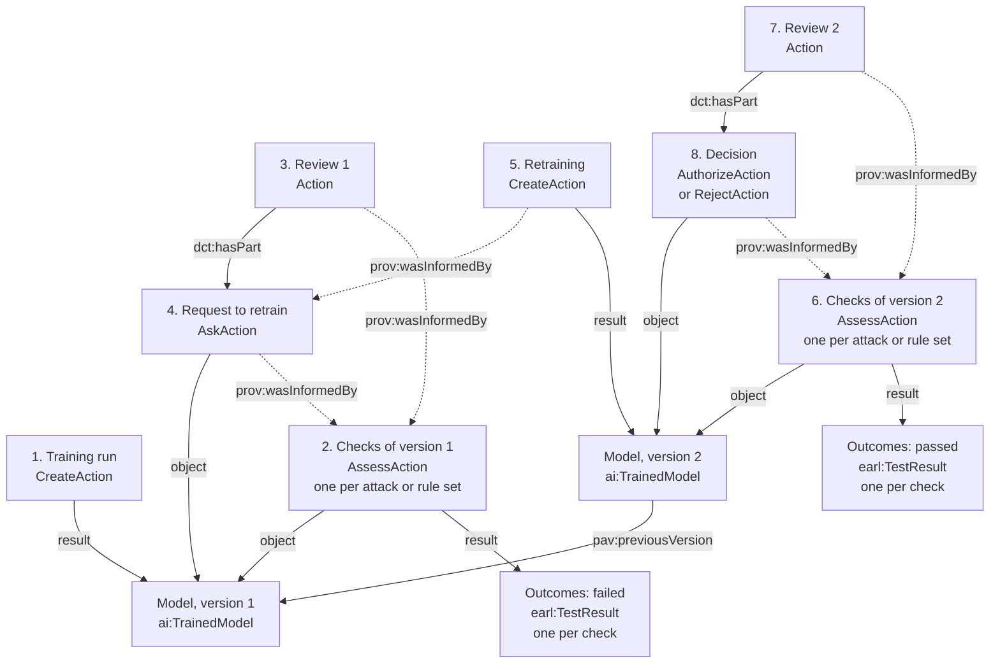

# Module: Trained Model Output Checking

Authors:

1. Ali Feizollah, The University of Manchester <https://orcid.org/0000-0003-2439-8482>

A module of the [Five Safes RO-Crate profile](../index.md). It is declared alongside the core profile in an RO-Crate's `conformsTo`, as described in [Conformance and Modules](../index.md#conformance-and-modules).
 
* Permalink: <https://w3id.org/5s-crate/1.0-DRAFT/modules/trained-model-output-checking>
* Profile of: <https://w3id.org/5s-crate/1.0-DRAFT>, identified with `isProfileOf` on the module's Profile entity
* Version: 1.0-DRAFT
* Status: Working Draft
* Published: 2027-XX-XX
* Comments and suggestions: <https://github.com/eScienceLab/Five-Safes-RO-Crate/issues>

_The key words "MUST", "MUST NOT", "REQUIRED", "SHALL", "SHALL NOT", "SHOULD", "SHOULD NOT", "RECOMMENDED", "NOT RECOMMENDED", "MAY", and "OPTIONAL" in this document are to be interpreted as described in BCP 14 [[RFC2119](https://doi.org/10.17487/RFC2119)] [[RFC8174](https://doi.org/10.17487/RFC8174)] when, and only when, they appear in all capitals, as shown here._

## Scope
 
A model trained on data inside a TRE can reveal something about the people in that data, even though it holds no records itself. Someone with access to the model may be able to tell whether a particular person's record was used in training (membership inference), or work out a sensitive attribute of a person in the training data (attribute inference). TREs therefore check a trained model before it leaves, just as they check tables and figures.
 
The core profile already gives output checking its shape: a check is an `AssessAction`, a decision is an `AuthorizeAction` or `RejectAction`, a request for further action is an `AskAction`, and a review that groups them is an `Action` (see: [Output Checking and Release Decisions](../index.md#output-checking-and-release-decisions)). This module adds what is particular to models. With it, an RO-Crate answers four questions about every check of a model:
 
| Question | Recorded with |
|---|---|
| What was checked? | The model version, typed `ai:TrainedModel`, and the training run that produced it (see: [The Model](#the-model), [Training and Retraining](#training-and-retraining)). |
| What did the check look for? | The risk it examined, with `dpv:hasRisk` (see: [Checks](#checks)). |
| How was the check done? | The kind of check, the software, and the exact versions of the settings and criteria it applied (see: [Checks](#checks)). |
| What did it find? | An outcome from W3C EARL (see: [Outcomes](#outcomes)). |
 
Each answer uses terms from published vocabularies, apart from one term this module defines (see: [Terms and Context](#terms-and-context)). To conform to this module, an RO-Crate that already conforms to the core needs two additions: the module, declared in the Root Data Entity's `conformsTo` with its Profile entity, and `ai:TrainedModel` in the `additionalType` of each model it checks.
 
The module applies to any model whose parameters were learned from data in the TRE, including a model fine-tuned there from a base model, and to any kind of check of such a model: an attack that measures a risk, a test against rules, or a judgement by an output checker. It leaves out:
 
- statistical outputs, which are covered by [Statistical Output Checking](statistical-output-checking.md). A fitted model released only as a table of coefficients is a statistical output; released so that others can use it to make predictions, it is a trained model. An RO-Crate recording both kinds of check declares both modules;
- the detail of how a model was trained, beyond what checking needs;
- what happens to a model after release, such as serving it to users;
- validation tooling and SHACL shapes.

The module does not tell a TRE which checks to run, which tools to use, or where to set its thresholds; it records those choices without making them.

## The Checking Cycle
 
Checking a model is often a loop rather than a single step. When a check finds a problem, the output checker asks for changes, the researcher retrains, and the new version is checked again. Each step is a separate process in the RO-Crate:
 
1. **Training** produces a model version: a `CreateAction` (see: [Training and Retraining](#training-and-retraining)).
2. **Checks** examine that version, one for each attack or set of rules: `AssessAction`s (see: [Checks](#checks)), each with an outcome (see: [Outcomes](#outcomes)).
3. **The output checker reviews** the outcomes. The review may be recorded as one `Action` that holds its decisions and requests (see: [Reviews, Requests and Decisions](#reviews-requests-and-decisions)).
4. **A request to retrain** asks for specific changes: an `AskAction`.
5. **Retraining** produces a new model version, which names the version it replaces: a `CreateAction` informed by the request.
6. **The new version is checked** in the same way as before, so that the outcomes can be compared (see: [Comparing a Retrained Model with the Earlier Version](#comparing-a-retrained-model-with-the-earlier-version)).
7. **The output checker reviews again**, this time the outcomes of the new version. This second review is recorded like the first.
8. **The model is approved or refused** within that review: an `AuthorizeAction`, which may limit how the model is used, or a `RejectAction`.

If the new version still fails, the second review ends with another request, and steps 4 to 7 repeat.
 


## The Model
 
The model is the output being checked. Each version is a separate asset with its own absolute IRI, so that checks, decisions and other RO-Crates can name exactly the version they concern. Its DPV AI type is what tells a consumer, and this module, that the asset is a trained model.
 
| Property | Requirement | Description |
|---|---|---|
| `@id` | MUST be an absolute IRI | Identifies one exact model version. |
| `additionalType` | MUST include `ai:TrainedModel`, or a narrower DPV term such as `ai:FineTunedModel` | Marks the asset as a trained model. A check of such an asset is a [trained model output check](#checks). |
| `name`, `version`, `author` | SHOULD; `author` where known | As the core asks of a trained-model asset (see: [Software and Models](../index.md#software-and-models)). `version` is text, such as `"1"`. |
| `pav:previousVersion` | SHOULD, on a model retrained or otherwise revised after a request | The version it replaces, as its immediate predecessor. |
| `prov:wasDerivedFrom` | SHOULD identify a base model the model was fine-tuned from | Only where the model was made from that model, as [Derived Data](../index.md#derived-data) requires. Retraining from data does not make a model from the earlier version, so the earlier version is named with `pav:previousVersion` instead. |
| `ai:hasTechnique` | MAY identify the techniques the model uses | For example `ai:SupervisedLearning` and `ai:DecisionTree`. |
| `ai:hasCapability` | MAY identify what the model is for | For example `ai:TextClassification`. DPV AI 2.3 has no capability for classification or prediction from tabular data, so many TRE models have none for now. |
 
```json
{
  "@id": "https://tre72.example.org/activities/A123/assets/model/v1",
  "@type": "File",
  "additionalType": {"@id": "https://w3id.org/dpv/ai#TrainedModel"},
  "name": "Random forest classifier, version 1",
  "version": "1",
  "author": {"@id": "https://orcid.org/0000-0002-1825-0097"},
  "ai:hasTechnique": [
    {"@id": "https://w3id.org/dpv/ai#SupervisedLearning"},
    {"@id": "https://w3id.org/dpv/ai#DecisionTree"}
  ]
}
```

### Copies of a Model
 
A model is usually checked while it is still inside the TRE, so the RO-Crate can describe it by its IRI alone, with no copy of its files. When a copy is included, it is a separate entity that points to the model, as the core requires for [packaged copies](../index.md#packaged-copies-of-identified-assets): a single file points to it with `encodesCreativeWork`, and a directory of files, such as weights and a configuration, with `exampleOfWork`. A report produced by a check is not a copy of the model; it is part of the check's `result`.

## Training and Retraining
 
A checker often needs to know how a model was produced, and retraining is how a model is changed after a failed check. A **training run** is a `CreateAction` whose `result` is a trained model. Where an RO-Crate records one:
 
| Property | Requirement | Description |
|---|---|---|
| `result` | MUST identify the model version | As the core requires of a completed `CreateAction` that produced an asset. |
| `object` | SHOULD identify the exact version of the training data | |
| `instrument` | SHOULD identify the software and the exact version of the training settings | Naming a settings version lets two training runs be compared. |
| `additionalType` | MAY include `ai:ModelTraining`, or `ai:ModelFineTuning` | |
| `prov:wasInformedBy` | SHOULD identify the request, where the run retrains a model at an output checker's request | Records why the new version was made. |
 
Training settings, such as a model's hyperparameters, are an asset of their own: a `CreativeWork` with an absolute IRI and a `version`, with a copy of the settings file linked by `encodesCreativeWork`. When the settings change, the new settings are a new version that names the old one with `pav:previousVersion`. A check's settings and criteria are recorded in the same way (see: [Checks](#checks)).
 
The following fragment shows the retraining that produced model v2: the run names the request that led to it and the new settings, and the new model names the version it replaces.
 
```json
[
  {
    "@id": "https://tre72.example.org/activities/A123/runs/train-2",
    "@type": ["CreateAction", "prov:Activity"],
    "additionalType": {"@id": "https://w3id.org/dpv/ai#ModelTraining"},
    "name": "Retrain random forest, version 2",
    "agent": {"@id": "https://orcid.org/0000-0002-1825-0097"},
    "provider": {"@id": "https://ror.org/027m9bs27"},
    "object": {"@id": "https://tre72.example.org/activities/A123/assets/train-data/v1"},
    "instrument": [
      {"@id": "https://pypi.org/project/scikit-learn/1.8.0/"},
      {"@id": "https://tre72.example.org/activities/A123/settings/train/v2"}
    ],
    "result": {"@id": "https://tre72.example.org/activities/A123/assets/model/v2"},
    "prov:wasInformedBy": {"@id": "https://tre72.example.org/activities/A123/requests/retrain-model"},
    "startTime": "2027-04-10T09:00:00Z",
    "endTime": "2027-04-10T09:25:00Z",
    "actionStatus": {"@id": "http://schema.org/CompletedActionStatus"}
  },
  {
    "@id": "https://tre72.example.org/activities/A123/settings/train/v2",
    "@type": "CreativeWork",
    "name": "Training settings for the random forest, version 2",
    "version": "2",
    "pav:previousVersion": {"@id": "https://tre72.example.org/activities/A123/settings/train/v1"}
  },
  {
    "@id": "https://tre72.example.org/activities/A123/assets/model/v2",
    "@type": "File",
    "additionalType": {"@id": "https://w3id.org/dpv/ai#TrainedModel"},
    "name": "Random forest classifier, version 2",
    "version": "2",
    "author": {"@id": "https://orcid.org/0000-0002-1825-0097"},
    "pav:previousVersion": {"@id": "https://tre72.example.org/activities/A123/assets/model/v1"}
  }
]
```

## Checks
 
A **trained model output check** is an `AssessAction` whose `object` includes a trained model; this is how the module recognises the checks it applies to. Declaring this module means the RO-Crate records at least one such check: every working record and snapshot that declares it MUST list one or more in the Root Data Entity's `mentions`.
 
On top of the core's [output check](../index.md#output-checks), a check of a model records three things: the kind of check, the risk it looked at, and how it was done.
 
**Kind of check.** The kind describes how a check works, not what it looks for, and goes in `additionalType`:
 
- `risk:RiskAnalysis` for an attack simulation, which measures a risk by attacking the model;
- `dpv:ConformanceAssessment` for a test against rules or guidelines, such as a minimum number of training records in each leaf of a decision tree;
- `risk:RiskEvaluation` for a judgement of measured risk against the TRE's criteria, often made by a person;
- `risk:RiskAssessment` for a single check that does more than one of these.

**Risk it looked at.** The risk is the harm the check is about: what someone could do with the model after it is released. It is different from the check, which is what the TRE does before release. Different checks can be about the same risk. Take membership inference, the risk that someone finds out whether a person's record was used to train the model:

- an attack check measures that risk by attacking the model;
- a rules check tests the model against rules that keep the risk low, such as at least five training records in each leaf of a decision tree, so that no leaf describes a single person.

The same rules may also guard against other risks, so a check can name more than one.

The risk goes in `dpv:hasRisk`, as a published term. Common risks for trained models include:

- membership inference: `http://d3fend.mitre.org/ontologies/d3fend.owl#AML.T0024.000`, from MITRE D3FEND;
- attribute inference, working out a sensitive attribute of a person in the training data: [`#AttributeInference`](#terms-and-context), defined by this module;
- model inversion, reconstructing training data from the model: `https://w3id.org/dpv/ai#ModelInversion`, from DPV;
- re-identification, for example from small groups of training records that the model's structure reveals: `https://w3id.org/dpv/risk#Reidentification`, from DPV;
- data leakage from a language model that reveals sensitive training text when prompted: `http://d3fend.mitre.org/ontologies/d3fend.owl#AML.T0057`, from MITRE D3FEND.

A rule-based check names each risk its rules guard against, if the rules say which.
 
**How it was done.** A tool's name alone does not say how a check was done: the same tool can run an attack with weaker settings, or judge its results against looser criteria. A check therefore names, as its `instrument`, the software, the exact version of the settings it ran with, and the exact version of the criteria or rules that decided the outcome. Settings and criteria are versioned assets, like the training settings above. Criteria MAY carry `risk:RiskCriteria` in `additionalType`, and a set of rules MAY carry `dpv:Policy`.
 
| Property | Requirement | Description |
|---|---|---|
| `@type` | MUST include `AssessAction` | The core's [Process Shape](../index.md#process-shape) and [Output Checks](../index.md#output-checks) then apply; in particular, `object` identifies the exact model version. |
| `additionalType` | SHOULD include the kind of check | One of the four terms above, or another published term for a kind of check. |
| `dpv:hasRisk` | SHOULD identify each risk the check looked for | What the check looked for. |
| `instrument` | SHOULD identify the software, and the exact versions of the settings and of the criteria or rules, where each helped perform the check | Checks that name the same versions were done the same way. |
| `prov:used` | MAY identify data the check needed, such as the training and test data used by an attack | Not the model, which is the `object`. |
| `result` | SHOULD identify an [outcome](#outcomes) once `actionStatus` is `CompletedActionStatus`; <br><br> MAY identify a report; <br><br> MUST NOT identify an `AuthorizeAction` or `RejectAction` | A check that is still running, or that did not finish, has no outcome. |
 
Record a separate check for each attack or set of rules, so that each check has one kind and one outcome. A tool that runs several attacks in one session therefore produces several checks, which MAY share one report. When an output checker then judges a tool's results, that judgement is a further check, typically `risk:RiskEvaluation`, with the checker as `agent`, its own outcome, and `prov:wasInformedBy` the tool's check. Where the judgement is made outside the TRE, the further check has the other organisation as `agent` and names the report it judged with `prov:used`.
 
The following fragment records the membership inference attack on model v1, with its settings and the TRE's criteria:
 
```json
[
  {
    "@id": "https://tre72.example.org/activities/A123/checks/mia-1",
    "@type": ["AssessAction", "prov:Activity"],
    "additionalType": {"@id": "https://w3id.org/dpv/risk#RiskAnalysis"},
    "name": "Membership inference attack (LiRA) on model v1",
    "dpv:hasRisk": {"@id": "http://d3fend.mitre.org/ontologies/d3fend.owl#AML.T0024.000"},
    "agent": {"@id": "https://ror.org/027m9bs27"},
    "provider": {"@id": "https://ror.org/027m9bs27"},
    "object": {"@id": "https://tre72.example.org/activities/A123/assets/model/v1"},
    "instrument": [
      {"@id": "https://pypi.org/project/sacroml/2.0.1/"},
      {"@id": "https://tre72.example.org/activities/A123/settings/lira/v1"},
      {"@id": "https://tre72.example.org/policies/risk-criteria/v1"}
    ],
    "prov:used": [
      {"@id": "https://tre72.example.org/activities/A123/assets/train-data/v1"},
      {"@id": "https://tre72.example.org/activities/A123/assets/test-data/v1"}
    ],
    "result": [
      {"@id": "checks/model-v1/report.json"},
      {"@id": "https://tre72.example.org/activities/A123/checks/mia-1/outcome"}
    ],
    "startTime": "2027-04-02T10:00:00Z",
    "endTime": "2027-04-02T10:06:00Z",
    "actionStatus": {"@id": "http://schema.org/CompletedActionStatus"}
  },
  {
    "@id": "https://tre72.example.org/activities/A123/settings/lira/v1",
    "@type": "CreativeWork",
    "name": "LiRA attack settings, version 1",
    "version": "1"
  },
  {
    "@id": "https://tre72.example.org/policies/risk-criteria/v1",
    "@type": "CreativeWork",
    "additionalType": {"@id": "https://w3id.org/dpv/risk#RiskCriteria"},
    "name": "TRE72 risk criteria for output checking, version 1",
    "version": "1"
  }
]
```

## Outcomes
 
What a check found is recorded with the W3C [Evaluation and Report Language (EARL) 1.0](https://www.w3.org/TR/EARL10-Schema/), so that software can read it without knowing this module. The outcome is a small entity of its own, typed `earl:TestResult` and listed under the check's `result`.
 
| Value | The check found that | Not to be read as |
|---|---|---|
| `http://www.w3.org/ns/earl#passed` | the model met every criterion it was checked against | approval to release |
| `http://www.w3.org/ns/earl#failed` | the model did not meet at least one criterion | a refusal |
| `http://www.w3.org/ns/earl#cantTell` | the result needs a person's judgement before it means pass or fail | a decision, or evidence that a review took place |
| `http://www.w3.org/ns/earl#inapplicable` | the criteria do not apply to this kind of model, such as a rule written only for decision trees | a pass |
 
EARL's fifth value, `earl:untested`, is not used here: a check that was never carried out is not recorded as completed.
 
| Property | Requirement | Description |
|---|---|---|
| `@id` | MUST be an absolute IRI | |
| `@type` | MUST include `earl:TestResult` | |
| `earl:outcome` | MUST, exactly one of the four values above | |
| `about` | SHOULD identify the model, where the check examined more than one | Each model then has its own outcome. |
| `description` | SHOULD | What was found, in a sentence. Detailed metrics stay in the report, and results for individual training records never go in the metadata. |
 
Each outcome belongs to exactly one check, which MUST list it under `result`; checking the same model again is a new check with a new outcome. An `AuthorizeAction`, `RejectAction` or `AskAction` MUST NOT be typed `earl:TestResult` or carry `earl:outcome`, so that what a check found is never confused with what the TRE decided or a researcher asked.
 
```json
{
  "@id": "https://tre72.example.org/activities/A123/checks/mia-1/outcome",
  "@type": "earl:TestResult",
  "name": "Outcome of the membership inference check on model v1",
  "earl:outcome": {"@id": "http://www.w3.org/ns/earl#failed"},
  "description": "Likelihood-ratio attack with 100 shadow models: AUC 0.718, significant at p = 0.05."
}
```
 
**From measurement to outcome.** Many attacks produce numbers, such as an AUC and a p-value, rather than a verdict. The outcome is what those numbers mean under the criteria the check names as its `instrument`. A check that applied several rules records one outcome, normally the worst of the individual results: `earl:failed` is worse than `earl:cantTell`, which is worse than `earl:passed`. Its `description` names any rule that failed or did not apply.
 
## Reviews, Requests and Decisions
 
Reviews, requests and decisions about a model follow the core without change (see: [Release Decisions and Requests](../index.md#release-decisions-and-requests), [Requests, Plans, and Execution](../index.md#requests-plans-and-execution), and [Decision Subjects and Provenance](../index.md#decision-subjects-and-provenance)). For models, these points matter most:
 
- **A passed check is not an approval, and a failed check is not a refusal.** Release needs an `AuthorizeAction`, and refusal a `RejectAction`.
- **A review is optional.** Where decisions or requests are recorded as belonging to one review, the core requires an overall `Action` that lists them with `dct:hasPart`. A check made during the review is also one of its parts, while an earlier check, such as a tool's run before the review, informs it through `prov:wasInformedBy`. Without a review, each decision and request still names the checks that informed it.
- **A request to retrain says what to change.** It is an `AskAction` with the researcher as `recipient`, the model version as its `object`, `prov:wasInformedBy` every check that informed it, and the change asked for, such as a minimum leaf size, in its `description`. That description is the record of what the next version is expected to change.

```json
{
  "@id": "https://tre72.example.org/activities/A123/requests/retrain-model",
  "@type": ["AskAction", "prov:Activity"],
  "name": "Request to retrain the model",
  "description": "Increase min_samples_leaf to at least 5, retrain, and resubmit for checking.",
  "agent": {"@id": "https://tre72.example.org/staff/0417"},
  "provider": {"@id": "https://ror.org/027m9bs27"},
  "object": {"@id": "https://tre72.example.org/activities/A123/assets/model/v1"},
  "recipient": {"@id": "https://orcid.org/0000-0002-1825-0097"},
  "prov:wasInformedBy": [
    {"@id": "https://tre72.example.org/activities/A123/checks/mia-1"},
    {"@id": "https://tre72.example.org/activities/A123/checks/aia-1"},
    {"@id": "https://tre72.example.org/activities/A123/checks/rules-1"}
  ],
  "endTime": "2027-04-03T15:00:00Z",
  "actionStatus": {"@id": "http://schema.org/CompletedActionStatus"}
}
```
 
## Comparing a Retrained Model with the Earlier Version
 
A pass for a retrained model only means something if two things hold: the model changed in the way that was asked, and its new checks were as demanding as the old ones. Both can be read from the RO-Crate without opening the reports:
 
| Question | Where the answer is |
|---|---|
| What was the researcher asked to change? | The `description` of the request that the retraining names with `prov:wasInformedBy`. |
| What actually changed? | The two training runs: their data (`object`), their software, and their settings versions (`instrument`). Comparing the two settings files gives the exact difference, such as `min_samples_leaf` going from 1 to 5. |
| Were the new checks as demanding? | Pair each check of the new version with the check of the earlier version that has the same kind and the same risks. If both name the same software, settings and criteria versions as `instrument`, they were done the same way. |
 
Some checking tools record the settings of the model they examine, so a TRE can often fill in the training settings without asking the researcher. Changes that no tool can see, such as a different way of preparing the data, still need the researcher's own `description` of the training run.

## Terms and Context
 
The module defines one term of its own, because no published vocabulary has it. Its namespace is `https://w3id.org/5s-crate/1.0-DRAFT/modules/trained-model-output-checking#`:
 
| Term | Where it is used | Meaning |
|---|---|---|
| `#AttributeInference` | A value of `dpv:hasRisk` | An attack that infers a sensitive attribute of a person from a model trained on their data. Broader term: `https://w3id.org/dpv/ai#ModelInversion`. |
 
All other terms are published elsewhere:
 
| Vocabulary | Namespace (prefix) | Used here for |
|---|---|---|
| W3C [Evaluation and Report Language (EARL) 1.0](https://www.w3.org/TR/EARL10-Schema/) | `http://www.w3.org/ns/earl#` (`earl:`) | Outcomes: `TestResult`, `outcome` and the four values. |
| [Data Privacy Vocabulary](https://w3id.org/dpv) 2.3, with its [Risk](https://w3id.org/dpv/risk) and [AI](https://w3id.org/dpv/ai) extensions | `https://w3id.org/dpv#` (`dpv:`), `https://w3id.org/dpv/risk#` (`risk:`), `https://w3id.org/dpv/ai#` (`ai:`) | Kinds of check; `hasRisk`, and risks such as `ModelInversion` and `Reidentification`; `RiskCriteria` and `Policy`; the model's type, training, techniques and capabilities. |
| [MITRE D3FEND](https://d3fend.mitre.org/) 1.6.0 | `http://d3fend.mitre.org/ontologies/d3fend.owl#` (`d3f:`) | Risks: membership inference (`AML.T0024.000`) and data leakage from a language model (`AML.T0057`). |
| [PAV](https://pav-ontology.github.io/pav/) | `http://purl.org/pav/` (`pav:`) | `previousVersion`. |
 
The RO-Crate context binds `pav`, but not `earl`, `dpv`, `risk` or `ai`. Every property or type from those four vocabularies MUST expand to its full IRI: written with a prefix, it needs the module context after the RO-Crate context; written as a full IRI, it needs none. Terms used as values are always written as full IRIs and need no context. The module context is:
 
```json
{
  "@context": [
    "https://w3id.org/ro/crate/1.3/context",
    {
      "earl": "http://www.w3.org/ns/earl#",
      "dpv": "https://w3id.org/dpv#",
      "risk": "https://w3id.org/dpv/risk#",
      "ai": "https://w3id.org/dpv/ai#"
    }
  ]
}
```
