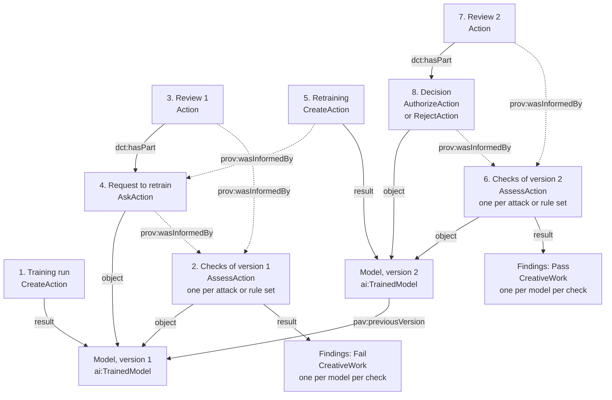

# Module: Trained Model Output Checking

Authors:

1. Ali Feizollah, The University of Manchester <https://orcid.org/0000-0003-2439-8482>

A module of the [Five Safes RO-Crate profile](../index.md). It is declared alongside the core profile in an RO-Crate's `conformsTo`, as described in [Conformance and Modules](../index.md#conformance-and-modules).
 
* Permalink: <https://w3id.org/5s-crate/1.0-DRAFT/modules/trained-model-output-checking>
* Profile of: <https://w3id.org/5s-crate/1.0-DRAFT>, identified with `isProfileOf` on the module's Profile entity
* Version: 1.0-DRAFT
* Status: Working Draft
* Published: 2027-XX-XX
* Comments and suggestions: <https://github.com/eScienceLab/Five-Safes-RO-Crate/issues>

_The key words "MUST", "MUST NOT", "REQUIRED", "SHALL", "SHALL NOT", "SHOULD", "SHOULD NOT", "RECOMMENDED", "NOT RECOMMENDED", "MAY", and "OPTIONAL" in this document are to be interpreted as described in BCP 14 [[RFC2119](https://doi.org/10.17487/RFC2119)] [[RFC8174](https://doi.org/10.17487/RFC8174)] when, and only when, they appear in all capitals, as shown here._

## Scope
 
A model trained on data inside a TRE can reveal something about the people in that data, and may retain or memorise training records. Someone with access to the model may be able to tell whether a particular person's record was used in training (membership inference), or work out a sensitive attribute of a person in the training data (attribute inference). TREs therefore check a trained model before it leaves, just as they check tables and figures.
 
The core profile already gives output checking its shape: a check is an `AssessAction`, a decision is an `AuthorizeAction` or `RejectAction`, a request for further action is an `AskAction`, and a review that groups them is an `Action` (see: [Output Checking and Release Decisions](../index.md#output-checking-and-release-decisions)). This module adds what is particular to models. With it, an RO-Crate can answers four questions about every check of a model:
 
| Question | Recorded with |
|---|---|
| What was checked? | The model version, typed `ai:TrainedModel`, and the training run that produced it (see: [The Model](#the-model), [Training and Retraining](#training-and-retraining)). |
| What did the check look for? | The risk it examined, with `dct:subject`, from the risks the model lists under `dpv:hasRisk` (see: [The Model](#the-model), [Checks](#checks)). |
| How was the check done? | The kind of check, the software, and the exact versions of the settings and criteria it applied (see: [Checks](#checks)). |
| What did it find? | A finding for each model, with one of the outcome terms of Statistical Output Checking (see: [Outcomes](#outcomes)). |
 
Each answer uses terms from published vocabularies, apart from two risks this module defines (see: [Terms and Context](#terms-and-context)). To conform to this module, an RO-Crate that already conforms to the core needs three additions: the module, declared in the Root Data Entity's `conformsTo` with its Profile entity; the module term `#TrainedModelOutputCheck` in the `additionalType` of each [trained model output check](#checks); and `ai:TrainedModel` in the `additionalType` of each model those checks examine.
 
The module applies to any model whose parameters were learned from data in the TRE, including a model fine-tuned there from a base model, and to any kind of check of such a model: an attack that measures a risk, a test against rules, or a judgement by an output checker. It leaves out:
 
- statistical outputs, which are covered by [Statistical Output Checking](statistical-output-checking.md). A fitted model released only as a table of coefficients is a statistical output; released so that others can use it to make predictions, it is a trained model. An RO-Crate recording both kinds of check declares both modules;
- the detail of how a model was trained, such as training logs, loss curves, intermediate checkpoints or the hardware used. The module records only the parts of training that checking uses: the run that produced the model, with its inputs, software and settings, and any request it answered;
- what happens to a model after release, such as serving it to users;
- validation tooling and SHACL shapes.

The module does not tell a TRE which checks to run, which tools to use, or where to set its thresholds; it records those choices without making them.

## The Checking Cycle
 
Checking a model is often a loop rather than a single step. When a check finds a problem, the output checker asks for changes, the researcher retrains, and the new version is checked again. Each step is a separate process in the RO-Crate:
 
1. **Training** produces a model version: a `CreateAction` (see: [Training and Retraining](#training-and-retraining)).
2. **Checks** examine that version, one for each attack or set of rules: `AssessAction`s (see: [Checks](#checks)), each with a finding for each model it examined (see: [Outcomes](#outcomes)).
3. **The output checker reviews** the outcomes. The review may be recorded as one `Action` that holds its decisions and requests (see: [Reviews, Requests and Decisions](#reviews-requests-and-decisions)).
4. **A request to retrain** asks for specific changes: an `AskAction`.
5. **Retraining** produces a new model version, which names the version it replaces: a `CreateAction` informed by the request.
6. **The new version is checked** in the same way as before, so that the outcomes can be compared (see: [Comparing a Retrained Model with the Earlier Version](#comparing-a-retrained-model-with-the-earlier-version)).
7. **The output checker reviews again**, this time the outcomes of the new version. This second review is recorded like the first.
8. **The model is approved or refused** within that review: an `AuthorizeAction`, which may set conditions on how the model is used, or a `RejectAction` (see: [Reviews, Requests and Decisions](#reviews-requests-and-decisions)). The researcher may ask for an exception before or after the decision.

If the new version still fails, the second review ends with another request, and steps 4 to 7 repeat.
 


## The Model
 
The model is the output being checked. In this module, a **trained model** is an asset whose `additionalType` includes `ai:TrainedModel`, or a narrower DPV term such as `ai:FineTunedModel`, and every [trained model output check](#checks) names at least one in its `object`. Each version is a separate asset with its own absolute IRI, so that checks, decisions and other RO-Crates can name exactly the version they concern.
 
| Property | Requirement | Description |
|---|---|---|
| `@id` | MUST be an absolute IRI | Identifies one exact model version. |
| `@type` | SHOULD be `Dataset` for a model held as several files, such as weights and a configuration, or `File` for a model held as one file | As the core allows for an exact trained-model version (see: [Kinds of Asset](../index.md#kinds-of-asset)). |
| `additionalType` | Includes `ai:TrainedModel`, or a narrower DPV term such as `ai:FineTunedModel` | Marks the asset as a trained model. The rule is on the check: every [trained model output check](#checks) names at least one such asset in its `object`. |
| `name`, `version`, `author` | SHOULD; `author` where known | As the core asks of a trained-model asset (see: [Software and Models](../index.md#software-and-models)). `version` is text, such as `"1"`. |
| `pav:previousVersion` | SHOULD, on a model retrained or otherwise revised after a request | The version it replaces, as its immediate predecessor. |
| `prov:wasDerivedFrom` | SHOULD identify each model this one was made from, such as a base model it was fine-tuned from, or an earlier version whose weights training continued from | Only where the model was made from that model, as [Derived Data](../index.md#derived-data) requires. A version retrained from scratch is not made from the earlier version, so it names the earlier version with `pav:previousVersion` only. A version trained further from the earlier version's weights is made from it, so it carries both `pav:previousVersion` and `prov:wasDerivedFrom`. |
| `ai:hasTechnique` | MAY identify the techniques the model uses | For example `ai:SupervisedLearning` and `ai:DecisionTree`. |
| `ai:hasCapability` | MAY identify what the model is for | For example `ai:TextClassification`. DPV AI 2.3 has no capability for classification or prediction from tabular data, so many TRE models have none for now. |
| `dpv:hasRisk` | SHOULD identify each risk that applies to the model | A published term for the harm the model could cause after release, from the list under [Checks](#checks). As in [Statistical Output Checking](statistical-output-checking.md), the risk is recorded on the output. |
 
```json
{
  "@id": "https://tre72.example.org/activities/A123/assets/model/v1",
  "@type": "Dataset",
  "additionalType": {"@id": "https://w3id.org/dpv/ai#TrainedModel"},
  "name": "Random forest classifier, version 1",
  "version": "1",
  "author": {"@id": "https://orcid.org/0000-0002-1825-0097"},
  "dpv:hasRisk": [
    {"@id": "https://w3id.org/5s-crate/1.0-DRAFT/modules/trained-model-output-checking#MembershipInference"},
    {"@id": "https://w3id.org/5s-crate/1.0-DRAFT/modules/trained-model-output-checking#AttributeInference"}
  ],
  "ai:hasTechnique": [
    {"@id": "https://w3id.org/dpv/ai#SupervisedLearning"},
    {"@id": "https://w3id.org/dpv/ai#DecisionTree"}
  ]
}
```

### Copies of a Model
 
The checked unit is the model version as a whole, identified by its IRI: checks, requests and decisions name that IRI, not the individual files. A model is usually checked while it is still inside the TRE, so the RO-Crate can describe it by its IRI alone, with no copy of its files. When a copy is included, it is a separate entity that points to the model, as the core requires for [packaged copies](../index.md#packaged-copies-of-identified-assets): a single file points to it with `encodesCreativeWork`, and a directory with `exampleOfWork`. The directory lists the files that make up the model, such as weights, a configuration, optimiser state and inference code, under `hasPart`. A report produced by a check is not a copy of the model; it is part of the check's `result`.

### Model Cards

A model card, such as the `README.md` published with many models, describes a model's intended use, training data, performance and limitations. It is an asset of its own: a `CreativeWork` with an absolute IRI that identifies the model with `about`, and any copy held in the RO-Crate points to it with `encodesCreativeWork`. A model card released with the model is an output too. It often contains statistics about the training data, such as the number of training records in each group or the model's performance in each group, so it is checked like any other output and the decision that releases it names it in `object`, as it names the model.

## Training and Retraining
 
A checker often needs to know how a model was produced, and retraining is how a model is changed after a failed check. A **training run** is a `CreateAction` whose `result` is a trained model. Where an RO-Crate records one, this module asks only for what checking uses:
 
| Property | Requirement | Description |
|---|---|---|
| `result` | MUST identify the model version | As the core requires of a completed `CreateAction` that produced an asset. |
| `object` | SHOULD identify the exact version of the training data, and any existing model the training started from | An existing model is the starting point for fine-tuning or continued training. It is a source of the new model, as [Derived Data](../index.md#derived-data) describes. |
| `instrument` | SHOULD identify the software and the exact version of the training settings | Naming a settings version lets two training runs be compared. |
| `additionalType` | MAY include `ai:ModelTraining`, or `ai:ModelFineTuning` | |
| `prov:wasInformedBy` | SHOULD identify the request, where the run retrains a model at an output checker's request | Records why the new version was made. |
 
Training settings, such as a model's hyperparameters, are an asset of their own: a `CreativeWork` with an absolute IRI and a `version`, with a copy of the settings file linked by `encodesCreativeWork`. When the settings change, the new settings are a new version that names the old one with `pav:previousVersion`. A check's settings and criteria are recorded in the same way (see: [Checks](#checks)).
 
The following fragment shows the retraining that produced model v2: the run names the request that led to it and the new settings, and the new model names the version it replaces.
 
```json
[
  {
    "@id": "https://tre72.example.org/activities/A123/runs/train-2",
    "@type": ["CreateAction", "prov:Activity"],
    "additionalType": {"@id": "https://w3id.org/dpv/ai#ModelTraining"},
    "name": "Retrain random forest, version 2",
    "agent": {"@id": "https://orcid.org/0000-0002-1825-0097"},
    "provider": {"@id": "https://ror.org/027m9bs27"},
    "object": {"@id": "https://tre72.example.org/activities/A123/assets/train-data/v1"},
    "instrument": [
      {"@id": "https://pypi.org/project/scikit-learn/1.8.0/"},
      {"@id": "https://tre72.example.org/activities/A123/settings/train/v2"}
    ],
    "result": {"@id": "https://tre72.example.org/activities/A123/assets/model/v2"},
    "prov:wasInformedBy": {"@id": "https://tre72.example.org/activities/A123/requests/retrain-model"},
    "startTime": "2027-04-10T09:00:00Z",
    "endTime": "2027-04-10T09:25:00Z",
    "actionStatus": {"@id": "http://schema.org/CompletedActionStatus"}
  },
  {
    "@id": "https://tre72.example.org/activities/A123/settings/train/v2",
    "@type": "CreativeWork",
    "name": "Training settings for the random forest, version 2",
    "version": "2",
    "pav:previousVersion": {"@id": "https://tre72.example.org/activities/A123/settings/train/v1"}
  },
  {
    "@id": "https://tre72.example.org/activities/A123/assets/model/v2",
    "@type": "Dataset",
    "additionalType": {"@id": "https://w3id.org/dpv/ai#TrainedModel"},
    "name": "Random forest classifier, version 2",
    "version": "2",
    "author": {"@id": "https://orcid.org/0000-0002-1825-0097"},
    "pav:previousVersion": {"@id": "https://tre72.example.org/activities/A123/assets/model/v1"}
  }
]
```

## Checks
 
A **trained model output check** is an entity whose `additionalType` includes `https://w3id.org/5s-crate/1.0-DRAFT/modules/trained-model-output-checking#TrainedModelOutputCheck`. That value is how the module selects the checks it applies to: without it, an `AssessAction`, even one whose `object` is a trained model, such as a test of the model's accuracy, is an ordinary Five Safes RO-Crate check. A working record or snapshot that declares this module MUST record at least one trained model output check under the Root Data Entity's `mentions`.
 
On top of the core's [output check](../index.md#output-checks), a check of a model records three things: the kind of check, the risk it looked at, and how it was done.
 
**Kind of check.** The kind describes how a check works, not what it looks for, and goes in `additionalType`:
 
- `risk:RiskAnalysis` for an attack simulation, which measures a risk by attacking the model. A pass or fail that the tool reports automatically, against thresholds set in advance, is part of the analysis, not an evaluation;
- `dpv:ConformanceAssessment` for a test against rules or guidelines, such as a minimum number of training records in each leaf of a decision tree;
- `risk:RiskEvaluation` for a human judgement of whether a measured risk is acceptable under the TRE's criteria, such as an output checker's further check of a tool's results;
- `risk:RiskAssessment` for a single check that does more than one of these, such as an output checker who runs an attack and judges its result in the same check.

**Risk it looked at.** The risk is the harm the check is about: what someone could do with the model after it is released. It is different from the check, which is what the TRE does before release. Different checks can be about the same risk. Take membership inference, the risk that someone finds out whether a person's record was used to train the model:

- an attack check measures that risk by attacking the model;
- a rules check tests the model against rules that keep the risk low, such as at least five training records in each leaf of a decision tree, so that no leaf describes a single person.

The same rules may also guard against other risks, so a check can name more than one.

The risks that apply to a model go in the model's `dpv:hasRisk`, and each check names the ones it examined with `dct:subject`, using the same published terms. `dpv:hasRisk` is not used on the check itself, because its published meaning is that the risk applies to the check. Common risks for trained models include:

- membership inference: [`#MembershipInference`](#terms-and-context), defined by this module;
- attribute inference, working out a sensitive attribute of a person in the training data: [`#AttributeInference`](#terms-and-context), defined by this module;
- model inversion, reconstructing training data from the model: `https://w3id.org/dpv/ai#ModelInversion`, from DPV;
- re-identification, for example from small groups of training records that the model's structure reveals: `https://w3id.org/dpv/risk#Reidentification`, from DPV;
- disclosure of training data, for example by a language model that reveals sensitive training text when prompted: `https://w3id.org/dpv/risk#UnwantedDisclosureData`, from DPV.

A rule-based check names each risk its rules guard against, if the rules say which.
 
**How it was done.** A tool's name alone does not say how a check was done: the same tool can run an attack with weaker settings, or apply looser criteria to its results. A check therefore names, as its `instrument`, the software, the exact version of the settings it ran with, and the exact version of the criteria or rules that decided the outcome. Settings and criteria are versioned assets, like the training settings above. Criteria MAY carry `risk:RiskCriteria` in `additionalType`, and a set of rules MAY carry `dpv:Policy`.
 
| Property | Requirement | Description |
|---|---|---|
| `@type` | MUST include `AssessAction` | The core's [Process Shape](../index.md#process-shape) and [Output Checks](../index.md#output-checks) then apply; in particular, `object` identifies the exact model version. |
| `additionalType` | MUST include the module term; <br><br> SHOULD include the kind of check | The module term marks the check and is how it is selected. The kind is one of the four terms above, or another published term for a kind of check. |
| `object` | MUST include at least one trained model | An asset whose `additionalType` includes `ai:TrainedModel`, or a narrower DPV term (see: [The Model](#the-model)). |
| `dct:subject` | SHOULD identify each risk the check examined | Each SHOULD also be listed under the checked model's `dpv:hasRisk`. |
| `instrument` | SHOULD identify the software, and the exact versions of the settings and of the criteria or rules, where each helped perform the check | Checks that name the same versions used the same tools, settings and criteria, but were not necessarily equally demanding (see: [Comparing a Retrained Model with the Earlier Version](#comparing-a-retrained-model-with-the-earlier-version)). |
| `prov:used` | MAY identify data the check needed, such as the training and test data used by an attack | Not the model, which is the `object`. |
| `result` | SHOULD identify one [finding](#outcomes) for each `object`, once `actionStatus` is `CompletedActionStatus`; <br><br> MAY identify a report; <br><br> MUST NOT identify an `AuthorizeAction` or `RejectAction` | A check that is still running, or that did not finish, has no findings. |
 
Record a separate check for each attack or set of rules: a tool that runs several in one session SHOULD be recorded as several checks, which MAY share one report. This differs from [Statistical Output Checking](statistical-output-checking.md), where one session of a tool is one check: each attack has its own kind, risks, settings and criteria, and separate checks keep each finding with the attack that produced it. Each check records one finding for each model it examined (see: [Outcomes](#outcomes)).

An output checker who examines a tool's results themselves MAY record that as a further check, typically `risk:RiskEvaluation`, with the checker as `agent`, its own findings, and `prov:wasInformedBy` the tool's check. Where the checker only read the tool's findings and went on to decide, the review's or the decision's `prov:wasInformedBy` the tool's check is enough. 
 
The following fragment records the membership inference attack on model v1, with its settings and the TRE's criteria:
 
```json
[
  {
    "@id": "https://tre72.example.org/activities/A123/checks/mia-1",
    "@type": ["AssessAction", "prov:Activity"],
        "additionalType": [
      {"@id": "https://w3id.org/5s-crate/1.0-DRAFT/modules/trained-model-output-checking#TrainedModelOutputCheck"},
      {"@id": "https://w3id.org/dpv/risk#RiskAnalysis"}
    ],
    "name": "Membership inference attack (LiRA) on model v1",
    "dct:subject": {"@id": "https://w3id.org/5s-crate/1.0-DRAFT/modules/trained-model-output-checking#MembershipInference"},
    "agent": {"@id": "https://ror.org/027m9bs27"},
    "provider": {"@id": "https://ror.org/027m9bs27"},
    "object": {"@id": "https://tre72.example.org/activities/A123/assets/model/v1"},
    "instrument": [
      {"@id": "https://pypi.org/project/sacroml/2.0.1/"},
      {"@id": "https://tre72.example.org/activities/A123/settings/lira/v1"},
      {"@id": "https://tre72.example.org/policies/risk-criteria/v1"}
    ],
    "prov:used": [
      {"@id": "https://tre72.example.org/activities/A123/assets/train-data/v1"},
      {"@id": "https://tre72.example.org/activities/A123/assets/test-data/v1"}
    ],
    "result": [
      {"@id": "checks/model-v1/report.json"},
      {"@id": "https://tre72.example.org/activities/A123/checks/mia-1/findings/model-v1"}
    ],
    "startTime": "2027-04-02T10:00:00Z",
    "endTime": "2027-04-02T10:06:00Z",
    "actionStatus": {"@id": "http://schema.org/CompletedActionStatus"}
  },
  {
    "@id": "https://tre72.example.org/activities/A123/settings/lira/v1",
    "@type": "CreativeWork",
    "name": "LiRA attack settings, version 1",
    "version": "1"
  },
  {
    "@id": "https://tre72.example.org/policies/risk-criteria/v1",
    "@type": "CreativeWork",
    "additionalType": {"@id": "https://w3id.org/dpv/risk#RiskCriteria"},
    "name": "TRE72 risk criteria for output checking, version 1",
    "version": "1"
  }
]
```

## Outcomes
 
What a check found about each model is recorded as a **finding**, in the same way as in [Statistical Output Checking](statistical-output-checking.md): a `CreativeWork` listed under the check's `result`, with `about` naming one model and one outcome term in `additionalType`. This module uses the outcome terms of that module, so that an RO-Crate declaring both modules records every outcome in the same way. The terms are values, so they need no context.

| Term | Meaning | It is not |
|---|---|---|
| `https://w3id.org/5s-crate/1.0-DRAFT/modules/statistical-output-checking#Pass` | The output met every criterion the check applied to it. | Permission to release. |
| `https://w3id.org/5s-crate/1.0-DRAFT/modules/statistical-output-checking#Fail` | The output did not meet at least one criterion the check applied to it. | A refusal. |
| `https://w3id.org/5s-crate/1.0-DRAFT/modules/statistical-output-checking#NeedsReview` | The check could not settle the output without human judgement, or referred it to a person. | A decision, or a record that a review took place. |

| Property | Requirement | Description |
|---|---|---|
| `@id` | MUST be an absolute IRI | A finding is a contextual entity. |
| `@type` | MUST include `CreativeWork` | A finding is a record of what was found. |
| `additionalType` | MUST include exactly one of the three outcome terms | The outcome. |
| `about` | MUST, exactly one | The output the finding concerns, normally the model. It MUST be an `object` of the check that lists this finding under `result`. |
| `description` | SHOULD | What was found, in a sentence. Detailed metrics stay in the report, and results for individual training records never go in the metadata. |

A finding MUST be listed under `result` by exactly one check and concerns one output: a check that examined several models records one finding for each, and checking the same model again is a new check with new findings. An `AuthorizeAction`, `RejectAction` or `AskAction` MUST NOT carry an outcome term in `additionalType`, so that what a check found is never confused with what the TRE decided or a researcher asked.

```json
{
  "@id": "https://tre72.example.org/activities/A123/checks/mia-1/findings/model-v1",
  "@type": "CreativeWork",
  "additionalType": {"@id": "https://w3id.org/5s-crate/1.0-DRAFT/modules/statistical-output-checking#Fail"},
  "name": "Finding of the membership inference check on model v1",
  "about": {"@id": "https://tre72.example.org/activities/A123/assets/model/v1"},
  "description": "Likelihood-ratio attack with 100 shadow models: AUC 0.718, significant at p = 0.05."
}
```

**From measurement to outcome.** Many attacks produce numbers, such as an AUC and a p-value, rather than a verdict. The outcome is what those numbers mean under the criteria the check names as its `instrument`, and a tool that reports a pass, fail or review status maps to the three terms one-to-one. A check that applied several rules records one finding for each model, normally with the most severe of the individual results, in the order `#Fail` → `#NeedsReview` → `#Pass`. A rule that does not apply to the model, such as a rule written only for decision trees, is left out of that order and named in the `description`; where no rule applied, the finding is `#NeedsReview`.
 
## Reviews, Requests and Decisions

Reviews, requests and decisions about a model follow the core without change (see: [Release Decisions and Requests](../index.md#release-decisions-and-requests), [Requests, Plans, and Execution](../index.md#requests-plans-and-execution), and [Decision Subjects and Provenance](../index.md#decision-subjects-and-provenance)). A review is optional. Where decisions or requests are recorded as belonging to one review, the core requires an overall `Action` that lists them with `dct:hasPart`. A check made during the review is also one of its parts, while an earlier check, such as a tool's run before the review, informs it through `prov:wasInformedBy`. Without a review, each decision and request still names the checks that informed it.

The following table shows how the situations that arise when checking a model are recorded with those rules:

| Situation | Recorded as |
|---|---|
| A check finds nothing wrong | A `#Pass` finding. Release still needs an `AuthorizeAction`. |
| A check finds a problem | A `#Fail` finding, or `#NeedsReview` where a person's judgement is needed. Nothing is refused until a `RejectAction` is recorded. |
| The output checker asks for the model to be retrained | An `AskAction` with the researcher as `recipient`, the exact model version as `object`, `prov:wasInformedBy` every check that informed it, and the change asked for, such as a minimum leaf size, in `description`. |
| The researcher retrains after a request | A new model version, produced by a `CreateAction` that names the request with `prov:wasInformedBy`. The new version names the earlier one with `pav:previousVersion`, and checking it is a new check with new outcomes (see: [Training and Retraining](#training-and-retraining)). |
| The model is approved, with or without conditions | An `AuthorizeAction` with the exact model version as `object` and `prov:wasInformedBy` every check that informed it. Conditions, such as non-commercial research use only, go in its `description`. |
| The model is refused | A `RejectAction` with the exact model version as `object`, `prov:wasInformedBy` every check that informed it, and the reason in `description`. |
| The researcher asks for an exception before any decision exists | An `AskAction` with the researcher as `agent`, the TRE or output checker as `recipient`, the exact model version as its only `object`, the reason in `description`, `prov:wasInformedBy` the checks it disputes, and `endTime` when it was submitted. The decision that answers it has the same single `object` and names the request with `prov:wasInformedBy`. |
| The researcher asks for an exception after a refusal | The same `AskAction`, which also names the refusal with `prov:wasInformedBy`. An `AuthorizeAction` that grants it names the request, the refusal it reverses and the checks it drew on with `prov:wasInformedBy`; the refusal then no longer stands. |

The following fragment records the request to retrain model v1:

```json
{
  "@id": "https://tre72.example.org/activities/A123/requests/retrain-model",
  "@type": ["AskAction", "prov:Activity"],
  "name": "Request to retrain the model",
  "description": "Increase min_samples_leaf to at least 5, retrain, and resubmit for checking.",
  "agent": {"@id": "https://tre72.example.org/staff/0417"},
  "provider": {"@id": "https://ror.org/027m9bs27"},
  "object": {"@id": "https://tre72.example.org/activities/A123/assets/model/v1"},
  "recipient": {"@id": "https://orcid.org/0000-0002-1825-0097"},
  "prov:wasInformedBy": [
    {"@id": "https://tre72.example.org/activities/A123/checks/mia-1"},
    {"@id": "https://tre72.example.org/activities/A123/checks/aia-1"},
    {"@id": "https://tre72.example.org/activities/A123/checks/rules-1"}
  ],
  "endTime": "2027-04-03T15:00:00Z",
  "actionStatus": {"@id": "http://schema.org/CompletedActionStatus"}
}
```

The following fragment records an exception request for model v1, made before any decision, and the refusal that answers it:

```json
[
  {
    "@id": "https://tre72.example.org/activities/A123/requests/exception-model-v1",
    "@type": ["AskAction", "prov:Activity"],
    "name": "Exception requested for the random forest, version 1",
    "description": "The attack result is inflated: the test data shares duplicate records with the training data. Release is requested as the model stands.",
    "agent": {"@id": "https://orcid.org/0000-0002-1825-0097"},
    "provider": {"@id": "https://ror.org/027m9bs27"},
    "object": {"@id": "https://tre72.example.org/activities/A123/assets/model/v1"},
    "recipient": {"@id": "https://ror.org/027m9bs27"},
    "prov:wasInformedBy": {"@id": "https://tre72.example.org/activities/A123/checks/mia-1"},
    "endTime": "2027-04-02T16:00:00Z",
    "actionStatus": {"@id": "http://schema.org/CompletedActionStatus"}
  },
  {
    "@id": "https://tre72.example.org/activities/A123/decisions/refuse-model-v1",
    "@type": ["RejectAction", "prov:Activity"],
    "name": "Random forest, version 1, refused",
    "description": "Release refused under the TRE's release policy. The exception request was considered: the test data was checked and holds no duplicates of training records.",
    "agent": {"@id": "https://tre72.example.org/staff/0417"},
    "provider": {"@id": "https://ror.org/027m9bs27"},
    "object": {"@id": "https://tre72.example.org/activities/A123/assets/model/v1"},
    "prov:wasInformedBy": [
      {"@id": "https://tre72.example.org/activities/A123/requests/exception-model-v1"},
      {"@id": "https://tre72.example.org/activities/A123/checks/mia-1"},
      {"@id": "https://tre72.example.org/activities/A123/checks/aia-1"},
      {"@id": "https://tre72.example.org/activities/A123/checks/rules-1"}
    ],
    "endTime": "2027-04-03T14:55:00Z",
    "actionStatus": {"@id": "http://schema.org/CompletedActionStatus"}
  }
]
```
 
## Comparing a Retrained Model with the Earlier Version
 
A pass for a retrained model only means something if two things hold: the model changed in the way that was asked, and its new checks were as demanding as the old ones. In the working record or an internal snapshot, both can be read without opening the reports; the second needs the data each check used as well as its instruments:
 
| Question | Where the answer is |
|---|---|
| What was the researcher asked to change? | The `description` of the request that the retraining names with `prov:wasInformedBy`. |
| What actually changed? | The two training runs: their data (`object`), their software, and their settings versions (`instrument`). Comparing the two settings files gives the exact difference, such as `min_samples_leaf` going from 1 to 5. |
| Were the new checks as demanding? | Pair each check of the new version with the check of the earlier version that has the same kind and the same risks. Matching software, settings and criteria versions establishes only that those instruments were unchanged. Also compare the data identified by `prov:used` and any other inputs affecting attack strength; if their comparability cannot be established, the RO-Crate alone does not establish that the new check was as demanding. |
 
Some checking tools record the settings of the model they examine, so a TRE can often fill in the training settings without asking the researcher. Changes that no tool can see, such as a different way of preparing the data, still need the researcher's own `description` of the training run.

An [egress snapshot](../index.md#ro-crates-and-egress) may leave out or redact the reports, packaged settings files and optional descriptions, such as the request's `description`. A comparison made from an egress snapshot may therefore need the internal snapshot it was derived from, which the egress snapshot identifies with `prov:wasDerivedFrom`.

## Egress

An [egress snapshot](../index.md#ro-crates-and-egress) may retain the checks, the risks, the findings, the requests and the decisions. Report files, packaged settings files and optional descriptions can be left out or redacted, provided the retained entities and references still satisfy the core and this module. Results for individual training records, such as the records an attack identified as members, belong only in a report.

## Terms and Context
 
The module defines the following terms of its own, because no published vocabulary has them. Their namespace is `https://w3id.org/5s-crate/1.0-DRAFT/modules/trained-model-output-checking#`:
 
| Term | Where it is used | Meaning |
|---|---|---|
| `#TrainedModelOutputCheck` | A value of `additionalType` on a check | An assessment of one or more trained models for disclosure risk before release from a TRE, performed by a person, by software, or by both. |
| `#MembershipInference` | A risk: a value of `dpv:hasRisk` on a model, and of `dct:subject` on a check | The risk that someone finds out whether a person's record was used to train a model. Broader term: `https://w3id.org/dpv/ai#ModelInversion`. |
| `#AttributeInference` | A risk: a value of `dpv:hasRisk` on a model, and of `dct:subject` on a check | The risk that someone infers a sensitive attribute of a person from a model trained on their data. Broader term: `https://w3id.org/dpv/ai#ModelInversion`. |
 
All other terms are published elsewhere:
 
| Vocabulary | Namespace (prefix) | Used here for |
|---|---|---|
| [Statistical Output Checking](statistical-output-checking.md) | `https://w3id.org/5s-crate/1.0-DRAFT/modules/statistical-output-checking#` | The outcome terms `#Pass`, `#Fail` and `#NeedsReview`. |
| [Data Privacy Vocabulary](https://w3id.org/dpv) 2.3, with its [Risk](https://w3id.org/dpv/risk) and [AI](https://w3id.org/dpv/ai) extensions | `https://w3id.org/dpv#` (`dpv:`), `https://w3id.org/dpv/risk#` (`risk:`), `https://w3id.org/dpv/ai#` (`ai:`) | Kinds of check; `hasRisk`, and risks such as `ModelInversion`, `Reidentification` and `UnwantedDisclosureData`; `RiskCriteria` and `Policy`; the model's type, training, techniques and capabilities. |
| [DCMI Metadata Terms](https://www.dublincore.org/specifications/dublin-core/dcmi-terms/) | `http://purl.org/dc/terms/` (`dct:`) | `subject`, for the risks a check examined. |
| [PAV](https://pav-ontology.github.io/pav/) | `http://purl.org/pav/` (`pav:`) | `previousVersion`. |
 
The RO-Crate context binds `pav` and `dct`, but not `dpv`, `risk` or `ai`. Every property or type from those three vocabularies MUST expand to its full IRI: written with a prefix, it needs the module context, or definitions identical to it, after the RO-Crate context; written as a full IRI, it needs none. Terms used as values are always written as full IRIs and need no context. The module context binds the three prefixes:

```json
{
  "@context": [
    "https://w3id.org/ro/crate/1.3/context",
    {
      "dpv": "https://w3id.org/dpv#",
      "risk": "https://w3id.org/dpv/risk#",
      "ai": "https://w3id.org/dpv/ai#"
    }
  ]
}
```

The module's context IRI is `https://w3id.org/5s-crate/1.0-DRAFT/modules/trained-model-output-checking/context`. An RO-Crate MAY reference that IRI instead of embedding the definitions; embedding keeps validation possible where the IRI cannot be reached. The JSON fragments in this module are written as if the module context were in use.

!!! warning
    A prefix that is not bound does not raise a JSON-LD error. Without the module context, `dpv:hasRisk` is read as an IRI whose scheme is `dpv`, not as `https://w3id.org/dpv#hasRisk`, so the statement silently loses its meaning.
